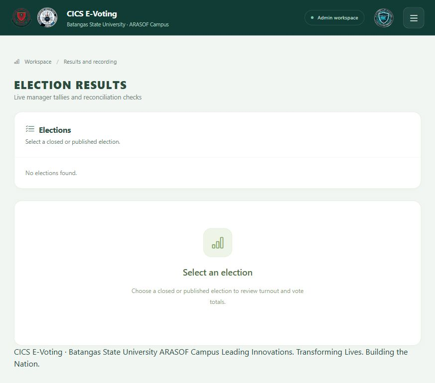
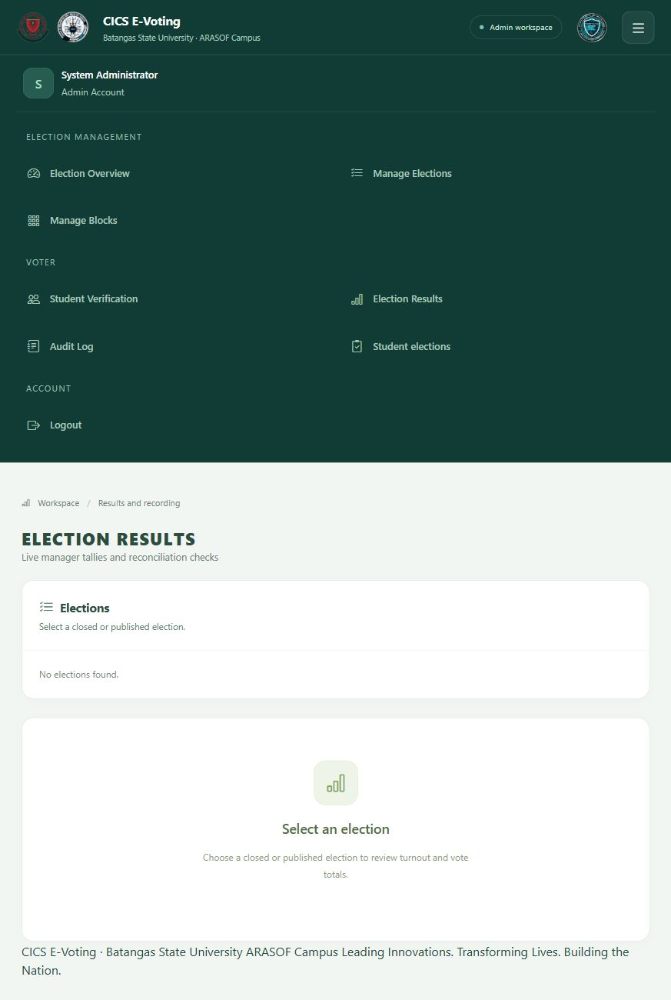
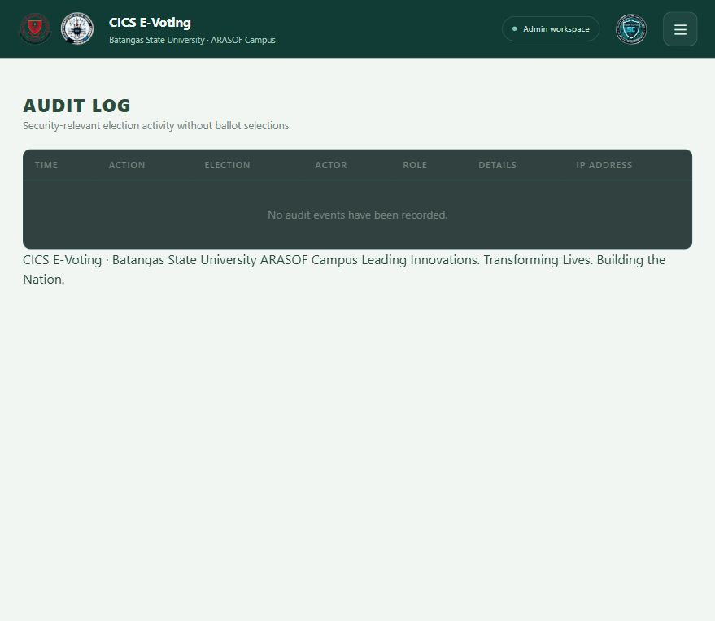
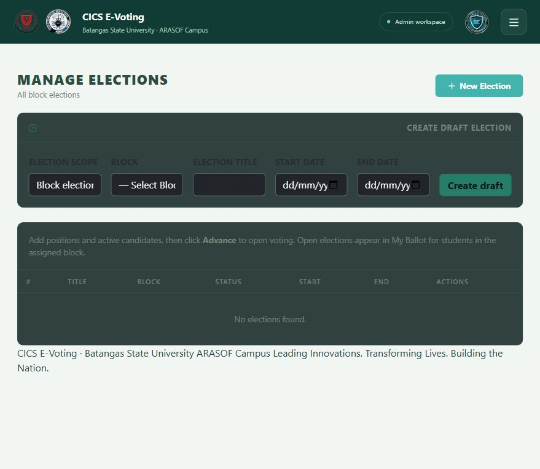

# E-Voting System — QA Test Cases

Build: d92d583. Local Laravel application with MySQL; automated tests use isolated SQLite. Results apply to this tested build only.

Status: PASS (Auto) = PHPUnit passed; PASS (Browser) = observed in browser; NOT RUN = needs execution. Browser screenshots below demonstrate UI states, not backend correctness.

| Test Case No. | What We Will Check | Expected Result | Status |
|---|---|---|---|
| TC-01 | Guest opens dashboard | Redirect to login | PASS (Auto) |
| TC-02 | Voter opens admin election management | Access denied | PASS (Auto) |
| TC-03 | Registration order | Student details requested before email verification | PASS (Auto) |
| TC-04 | OTP registration | OTP mail dispatched; account created only after verification | PASS (Auto; mail fake) |
| TC-05 | Expired OTP | Account creation rejected | PASS (Auto) |
| TC-06 | Existing email requests registration/OTP | Request rejected | PASS (Auto) |
| TC-07 | Block seeder | Eight blocks per supported year/major/semester combination | PASS (Auto) |
| TC-08 | Registration block choices | Major names shown; early years untracked | PASS (Auto) |
| TC-09 | First/second year registration | Save block without major | PASS (Auto) |
| TC-10 | Third/fourth year registration | Save matching major and block | PASS (Auto) |
| TC-11 | Wrong semester/major block | Registration rejected | PASS (Auto) |
| TC-12 | Invalid block form submission | Restore year, major, semester selections | PASS (Auto) |
| TC-13 | Admin block display | Full major names and distinguishable sections | PASS (Auto) |
| TC-14 | Manager dashboard | Manager name and election displayed | PASS (Auto) |
| TC-15 | Published results access | Own-scope published results allowed; closed/other-block results refused | PASS (Auto) |
| TC-16 | CICS-wide election access | Verified voters from different blocks see election | PASS (Auto) |
| TC-17 | CICS turnout | Count verified active voters across blocks | PASS (Auto) |
| TC-18 | Voter opens manager results/audit | Access denied | PASS (Auto) |
| TC-19 | Close/publish election | Audit entries and result snapshot created | PASS (Auto) |
| TC-20 | Open election without active candidates | Transition rejected; status remains configured | PASS (Auto) |
| TC-21 | Upload candidate profile | Credentials saved and photo stored on public disk | PASS (Auto) |
| TC-22 | Submit ballot twice | First saved; second rejected; only one receipt/vote | PASS (Auto) |
| TC-23 | Vote before scheduled start | Reject; no receipt/vote saved | PASS (Auto) |
| TC-24 | Inject position from another election | Reject entire ballot; no receipt/vote saved | PASS (Auto) |
| TC-25 | Voting record privacy | Only authenticated voter's receipts; no choices shown | PASS (Auto) |
| TC-26 | Published results and CSV | Aggregate counts and CSV export available | PASS (Auto) |
| TC-27 | Audit permissions/filter | Manager-only access; filter by election | PASS (Auto) |
| TC-28 | Results without elections | Clear selection/empty state, no error | PASS (Browser; S1) |
| TC-29 | Responsive menu | Toggle reveals admin navigation and destinations | PASS (Browser; S2) |
| TC-30 | Audit without events | Clear empty-state message | PASS (Browser; S3) |
| TC-31 | Election management page | Scope, block, title, dates and submit control visible | PASS (Browser; S4) |
| TC-32 | Complete browser election lifecycle with multiple voters | Configure, open, vote, close, publish and reconcile totals | NOT RUN |
| TC-33 | Real mailbox OTP delivery | Actual school mailbox receives usable OTP | NOT RUN |
| TC-34 | Concurrent ballot submissions under load | Exactly one accepted receipt per voter/election | NOT RUN |
| TC-35 | Full keyboard/screen-reader accessibility | All workflows usable without pointer | NOT RUN |

Automated run: 29 tests, 214 assertions passed. TC rows group related assertions; row count is not the PHPUnit test count. No real election data was created for these screenshots. Local database currently contains no elections.

## Screenshot evidence

S1 — Results page without elections (TC-28).

S2 — Expanded responsive menu (TC-29).

S3 — Audit page with no recorded events (TC-30).

S4 — Election configuration form and empty listing (TC-31).

